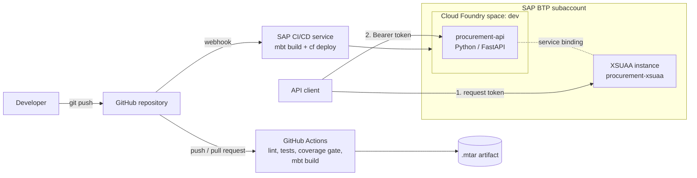

# procurement-ops-lab


A small procurement service (suppliers and purchase orders) built to practice the day-to-day work of a **DevOps engineer on SAP BTP**: deploying to Cloud Foundry, securing APIs with XSUAA, running CI/CD with both GitHub Actions and the SAP Continuous Integration and Delivery service, and troubleshooting what breaks along the way.

The application is intentionally simple. The focus is on how it is built, secured, delivered and operated.

## What this project demonstrates

| Area | How it is covered here |
|---|---|
| SAP BTP, Cloud Foundry | App packaged as an MTA and deployed to a Cloud Foundry space with `cf deploy` |
| Security | OAuth 2.0 with XSUAA: scopes, role templates and role collections defined in `xs-security.json`; JWT validation with `sap-xssec` |
| CI | GitHub Actions: lint (ruff), tests (pytest), 90% coverage gate, versioned `.mtar` artifact |
| CD | SAP Continuous Integration and Delivery service: build and deploy to `dev`, triggered by a GitHub webhook |
| Troubleshooting | Failures reproduced on purpose (crashes, missing bindings, invalid tokens, webhook and deploy errors) and documented with root cause |

## Architecture



## Tech stack

- **Application:** Python 3.12, FastAPI, Pydantic
- **Platform:** SAP BTP (Cloud Foundry environment), Multi-Target Application (MTA), Python buildpack
- **Security:** SAP Authorization and Trust Management (XSUAA), `sap-xssec`
- **CI/CD:** GitHub Actions, SAP Continuous Integration and Delivery service, Cloud MTA Build Tool (`mbt`)
- **Quality:** pytest with coverage, ruff (lint and formatting)

## API

| Method | Path | Required scope | Description |
|---|---|---|---|
| GET | `/health` | none | Liveness check used by Cloud Foundry; returns status and version |
| GET | `/me` | any valid token | Shows the caller identity, scopes and grant type (first stop when debugging a 403) |
| GET | `/suppliers` | Viewer | List suppliers |
| POST | `/suppliers` | Admin | Create a supplier |
| GET | `/purchase-orders` | Viewer | List purchase orders |
| POST | `/purchase-orders` | Admin | Create a purchase order (blocked suppliers are rejected) |
| POST | `/purchase-orders/{id}/{submit,approve,reject}` | Admin | Move a purchase order through its approval flow |

Purchase orders follow a simple release strategy: `DRAFT → SUBMITTED → APPROVED / REJECTED`. Invalid transitions return `409 Conflict`.

## Security model

```
Scope  →  Role template  →  Role collection  →  User
```

| Role collection | Scopes | Can do |
|---|---|---|
| `ProcurementViewer` | Viewer | Read suppliers and purchase orders |
| `ProcurementAdmin` | Viewer, Admin | Read and change everything |

Developers define scopes and role templates in `xs-security.json`. Administrators assign role collections to users in the BTP cockpit. The app only checks scopes, so access can change without touching the code.

The API returns:
- **401** when there is no token or the token is invalid
- **403** when the token is valid but the scope is missing
- **503** when the app is not bound to an XSUAA instance (an environment problem, not a code problem)

## CI/CD

**GitHub Actions** (`.github/workflows/ci.yml`) runs on every push to `main` and on every pull request:

1. `ruff check` and `ruff format --check`, with errors annotated inline on the pull request
2. `pytest` with a 90% coverage gate
3. `mbt build`, producing `procurement-ops-lab_<commit-sha>.mtar` as a build artifact

The build job only runs if tests pass, and the artifact name ties every package to the exact commit it came from.

**SAP CI/CD service** listens to pushes on `main` through a GitHub webhook, builds the MTA and deploys it to the `dev` space.

**Known gap (by design, for now):** the two pipelines are independent, so a commit with failing tests can still be deployed to `dev`. Branch protection on `main` and a single gated pipeline are the next steps (see Roadmap).

## Run locally

```bash
python -m venv .venv
source .venv/bin/activate          # Windows: .venv\Scripts\activate
pip install -r requirements-dev.txt

# AUTH_MODE=local replaces XSUAA with a fake Admin user. Never set it on Cloud Foundry.
AUTH_MODE=local uvicorn app.main:app --reload
# Open http://127.0.0.1:8000/docs
```

## Test

```bash
pytest --cov=app --cov-fail-under=90
ruff check . && ruff format --check .
```

Tests never call XSUAA. FastAPI dependency overrides replace the authenticated user (Admin, Viewer or anonymous), so the pipeline stays fast and does not depend on the network.

## Deploy to SAP BTP

```bash
cf login -a <api-endpoint>
mbt build
cf deploy mta_archives/procurement-ops-lab_<version>.mtar
```

The MTA creates the XSUAA instance and binds it to the app. Redeploying the same archive restores the binding if someone removes it by hand: the package is the source of truth.

## Repository layout

```
app/                  FastAPI application (models, routers, auth)
tests/                pytest suite, including auth scenarios (401/403/503)
.github/workflows/    GitHub Actions CI
mta.yaml              MTA descriptor: app module + XSUAA resource
xs-security.json      Scopes, role templates and role collections
runtime.txt           Python version for the Cloud Foundry buildpack
docs/cockpit/         Notes and screenshots of each BTP cockpit area used
LEARNING_LOG.md       Daily log: what was built, what broke and how it was fixed
```

## Design decisions

- **Python instead of CAP.** CAP only supports Node.js and Java. Python runs on Cloud Foundry through the Python buildpack, fits into an MTA as a `python` module and validates XSUAA tokens with `sap-xssec`.
- **MTA instead of `cf push`.** App and service dependencies ship together, the same package can be promoted across environments without rebuilding, and Cloud Transport Management can transport it.
- **In-memory storage, on purpose.** Scaling to two instances shows each instance with different data, a hands-on example of why cloud apps must be stateless. A managed database (SAP HANA Cloud or PostgreSQL) is the production answer.
- **Least privilege everywhere.** Read-only `GITHUB_TOKEN` in CI, a repository-scoped read-only token for the SAP CI/CD service, and technical clients that only get the scopes they need (Viewer, plus OrderIntake for the integration: it can create purchase orders but not approve them).

## SAP BTP trial limitations

- Deployments use a personal user. In a real landscape this would be a dedicated technical user.
- Blue-green deployment does not fit the trial memory quota, so `dev` uses standard deployment.
- The SAP HANA Cloud trial stops every night, which is one reason the app keeps in-memory storage.

## Roadmap

- [x] FastAPI service with tests and coverage gate
- [x] MTA deployment to Cloud Foundry
- [x] XSUAA security with role collections
- [x] GitHub Actions CI with versioned `.mtar` artifact
- [x] SAP CI/CD service with webhook-triggered deploy to `dev`
- [x] Manual approval gate with GitHub environments (required reviewer, `main` only, environment-scoped secrets)
- [x] Continuous deployment from GitHub Actions with approval gate; Destination service
- [x] Branch protection and tagged releases
- [x] Customer onboarding automation (Terraform providers for SAP BTP and Cloud Foundry, orchestrated by Python)
- [X] Jenkins with Project Piper
- [x] Promotion from DEV to PROD with SAP Cloud Transport Management
- [x] Structured logging, Alert Notification, scheduled health checks
- [x] SAP Integration Suite: cXML purchase order flow (Ariba style), see [integration/](integration/README.md)
- [ ] API Management in front of the flow (auth and rate limit)
- [x] Runbook, postmortem and architecture decision records


