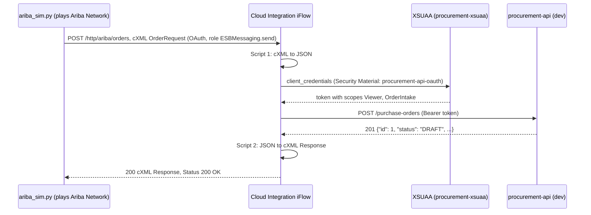

# Ariba order to procurement-api (SAP Integration Suite)

A purchase order created in SAP Ariba reaches `procurement-api` through Cloud Integration. There is no Ariba tenant in this lab, so `ariba_sim.py` plays SAP Ariba Network and sends the same kind of message: a cXML `OrderRequest` over HTTPS.

## Two credentials, two directions

| Direction | Who authenticates | Credential | Where it lives |
|---|---|---|---|
| Ariba to the iFlow | `ariba_sim.py` | Service key `ariba-sim` of the Process Integration Runtime instance `ariba-inbound` (plan `integration-flow`, role `ESBMessaging.send`) | Your terminal only, via environment variables |
| The iFlow to the API | Cloud Integration | Service key `integration-suite` of `procurement-xsuaa` | Security Material `procurement-api-oauth` in the tenant, never in the iFlow |

The technical client of `procurement-xsuaa` gets only `Viewer` and `OrderIntake` (from `authorities` in `xs-security.json`). It can create purchase orders, but cannot approve them or create suppliers: those still need a human with `Admin`.

## iFlow `ariba-order-to-procurement-api`

Package `procurement-ops-lab`. The iFlow is versioned in [`iflow/`](iflow/ariba-order-to-procurement-api) with the Git Push of Cloud Integration (Settings > Integrations > Git Access), on a feature branch and through a pull request like any other change. The tenant is the place where the iFlow is edited; the repository is its history.

In `iflow/`, the `.iflw` file is the flow itself (BPMN XML), and `src/main/resources/script/` holds the two Groovy scripts.

| Step | Type | Configuration |
|---|---|---|
| Sender | HTTPS adapter | Address `/ariba/orders`, Authorization `User Role`, role `ESBMessaging.send`, CSRF Protected off |
| Map cXML to JSON | Groovy Script | `iflow/ariba-order-to-procurement-api/src/main/resources/script/script1.groovy` |
| Call procurement-api | Request Reply + HTTP receiver | Address `https://<dev route>/purchase-orders`, Method `POST`, Authentication `OAuth2 Client Credentials`, Credential Name `procurement-api-oauth`, Request Headers `Content-Type`, Throw Exception on Failure on |
| Build cXML Response | Groovy Script | `iflow/ariba-order-to-procurement-api/src/main/resources/script/script2.groovy` (also forces HTTP 200, since cXML expects 200 even when the API answers 201) |

Field mapping:

| cXML | JSON |
|---|---|
| `OrderRequestHeader/Extrinsic[@name='SupplierID']` | `supplier_id` |
| `OrderRequestHeader/Total/Money/@currency` | `currency` |
| `ItemOut/ItemID/SupplierPartID` | `items[].material` |
| `ItemOut/@quantity` | `items[].quantity` |
| `ItemOut/ItemDetail/UnitPrice/Money` | `items[].unit_price` |

In a real landscape the supplier would come from the Ariba Network ID in `Header/To` and be translated with a Value Mapping. The lab passes the API's supplier id in an `Extrinsic`, which is the cXML element for custom fields.

## Script checks

The Cloud Integration script editor flags two patterns as "High", and both scripts follow the fix it asks for:

- XML parsing with DOCTYPE allowed (XXE risk): script 1 removes the standard cXML DOCTYPE and parses with `disallow-doctype-decl`.
- JSON parsing without streaming: script 2 reads the body as `java.io.Reader`.

`messageLogFactory` does not exist in the iFlow simulation, so the custom header calls sit in a `try/catch`.

## Samples

- `samples/order-request.xml`: input for the iFlow simulation of script 1.
- `samples/purchase-order.json`: what script 1 should produce.

## Known limits of the lab

- `procurement-api` keeps data in memory: a restart or deploy clears suppliers and orders, so create the supplier again before sending orders.
- No idempotency yet: sending the same `payloadID` twice creates two orders. A real flow would check the `payloadID` (for example with the Idempotent Process Call step).
- Errors return HTTP 500 to the sender instead of a cXML `Status` with a 4xx code.
